<div align="center">

# 🎬 UGC Ad KLing Pipeline

**AI-powered UGC ad video production — no GPU required.**

Turn winning ad patterns into rendered 9:16 videos using KLing AI inside ComfyUI.

[](LICENSE)
[](https://github.com/comfyanonymous/ComfyUI)
[](https://klingai.com)
[](https://python.org)

</div>

---

## What This Is

The **UGC Ad KLing Pipeline** is a hosted-API counterpart to the open-source [`ugc-ad-video-pipeline`](https://github.com/DevvGwardo/ugc-ad-video-pipeline). Same 8-step UGC ad workflow — but Steps 5–6 (text-to-image + image-to-video) and optional lip-sync/VO are replaced with **KLing AI API nodes** inside ComfyUI.

**The problem it solves:** Local image/video generation needs a 24GB+ GPU (RTX 4090) and struggles with complex motion, text-in-image, and lip-sync. This pipeline does all of that server-side — zero GPU required, $0.40–$1.50 per ad.

## How It Works

```mermaid
%%{
  init: {
    'theme': 'base',
    'themeVariables': {
      'primaryColor': '#7C3AED',
      'primaryTextColor': '#fff',
      'primaryBorderColor': '#7C3AED',
      'lineColor': '#A78BFA',
      'secondaryColor': '#1E1B4B',
      'tertiaryColor': '#0F0D2E',
      'fontFamily': 'system-ui, -apple-system, sans-serif'
    }
  }
}%%
graph TD
    subgraph Phase1["📊 Research & Strategy"]
        A["🔍 Swipe Competitor Ads<br/><small>Facebook Ad Library / IMH / SEJ</small>"] --> B["📝 Select Pattern<br/><small>Dollar+Timeframe • Anti-Hook<br/>Income Threshold • Confessional • Stakes</small>"]
        B --> C["✍️ Write Script + Storyboard<br/><small>Hook → Problem → Solution → CTA</small>"]
    end

    subgraph Phase2["🎨 Generate (KLing API — No GPU)"]
        C --> D{"Scene Mode?"}
        D -->|"Hook Card<br/>(static text)"| E["🖼️ ImageGen<br/><small>kling-v2-1 • 9:16</small>"]
        D -->|"Product Reveal<br/>(animate from image)"| F["🎥 Image2Video<br/><small>kling-v2-1-master • std/pro</small>"]
        D -->|"CTA / Ambient<br/>(text-only)"| G["📽️ Text2Video<br/><small>kling-v2-1-master • 9:16</small>"]
        E --> H["⬇️ Download Clip"]
        F --> H
        G --> H
        H --> I{"Voiceover?"}
        I -->|"Yes"| J["🗣️ LipSync<br/><small>TextInput → Sync to Clip</small>"]
        I -->|"No"| K["🔇 Video2Audio<br/><small>BGM + SFX</small>"]
        J --> L["🔁 Repeat for N Scenes"]
        K --> L
    end

    subgraph Phase3["✂️ Assembly"]
        L --> M["🎞️ ffmpeg Stitch<br/><small>Concat all scene clips</small>"]
        M --> N["💬 Whisper Captions<br/><small>Auto-generate .srt</small>"]
        N --> O["🎬 ffmpeg Burn-In<br/><small>White text + black stroke</small>"]
    end

    O --> P["✅ Final 9:16 Ad<br/><small>Ready to post</small>"]

    style Phase1 fill:#1E1B4B,stroke:#7C3AED,stroke-width:2px
    style Phase2 fill:#0F0D2E,stroke:#A78BFA,stroke-width:2px
    style Phase3 fill:#1E1B4B,stroke:#7C3AED,stroke-width:2px
    style P fill:#065F46,stroke:#34D399,stroke-width:2px,color:#fff
```



---

## Top Performing Patterns

| # | Pattern | Best Niche | Est. Cost / Ad | Example Hook |
|---|---------|-----------|----------------|-------------|
| 1 | **Dollar + Timeframe** | Fintech | $0.40–0.80 | *"I clawed back $4,217 in 90 days"* |
| 2 | **Anti-Hook / Warning** | SaaS, dev tools | $0.30–0.60 | *"Don't download another task app until you watch this"* |
| 3 | **Income Threshold Callout** | Fintech, freelancers | $0.50–1.00 | *"If you're a freelancer making over $50K, this is for you"* |
| 4 | **Confessional / "Nobody Told Me"** | Fintech, SaaS | $0.50–1.00 | *"Nobody told me about this tax loophole..."* |
| 5 | **Stakes / Fear Reveal** | Fintech, compliance | $0.80–1.50 | *"I almost missed an IRS deadline because I didn't know this"* |

---

## Quick Start

### 1. Install KLing ComfyUI Nodes

```bash
cd ComfyUI/custom_nodes
git clone https://github.com/KwaiVGI/ComfyUI-KLingAI-API
cd ComfyUI-KLingAI-API
pip install -r requirements.txt
```

### 2. Set API Key

Get your API key from [Kling AI Dev Center](https://app.klingai.com/global/dev/document-api/quickStart/productIntroduction/overview), then edit `config.ini`:

```ini
[API]
KLINGAI_API_ACCESS_KEY = your_access_key
KLINGAI_API_SECRET_KEY = your_secret_key
```

### 3. Pick a Pattern & Fill a Storyboard

```bash
cp storyboards/template.yaml storyboards/my_first_ad.yaml
# Edit the YAML with your product, hook, and scene prompts
```

### 4. Generate

```bash
pip install pyyaml requests
python scripts/storyboard_to_kling.py storyboards/my_first_ad.yaml
```

### 5. Caption & Export

```bash
whisper ugc_output/ugc_ad_final.mp4 --model small --output_dir ./captions
ffmpeg -i ugc_output/ugc_ad_final.mp4 \
  -vf "subtitles=./captions/ugc_ad_final.srt:force_style='FontName=Arial-Bold,FontSize=24,PrimaryCol=&H00FFFFFF,OutlineCol=&H00000000,BorderStyle=3,Outline=1,Shadow=1,MarginV=40'" \
  -c:a copy ugc_ad_captioned.mp4
```

---

## FOSS vs. KLing: When to Pick Which

| Factor | 🆓 FOSS Pipeline | ☁️ KLing Pipeline |
|--------|-----------------|-------------------|
| GPU needed | 24GB+ VRAM (4090/A100) | ❌ None — server-side |
| Cost per ad | ~$0.00 (electricity) | ~$0.50–$1.50 (API) |
| Commercial license | Depends on model | ✅ Check KLing terms |
| Quality ceiling | Good, artifacts in complex motion | Higher — human motion, cameras |
| Speed | 2–5 min / clip | 30–90s / clip |
| Lip-sync / VO | External tools | ✅ Built-in |
| Text in image | Unreliable | ✅ KLing v2 handles it |
| Video length | Up to 10s | 5s or 10s |

**Decision rule:**
- Have a 4090 and zero budget? → **FOSS**
- Need commercial quality, no GPU, or built-in lip-sync? → **KLing**
- Both? → KLing for hero clips, FOSS for experimentation

---

## Example Workflows

Each workflow in `examples/` is a complete, runnable prompt set for a specific pattern:

| Example | Niche | Scenes | Est. Cost |
|---------|-------|--------|-----------|
| [`dollar-timeframe.md`](examples/dollar-timeframe.md) | Fintech | 4 (hook → coffee scene → app reveal → CTA) | $0.40–0.80 |
| [`humblebrag-origin.md`](examples/humblebrag-origin.md) | Dev tools | 4 (messy desk → code deploy → product → CTA) | $0.50–1.20 |
| [`chaos-order.md`](examples/chaos-order.md) | SaaS | 4 (split screen → problem → solution → CTA) | $0.40–0.80 |

---

## Repo Structure

```
ugc-ad-kling-pipeline/
├── README.md                    # This file
├── scripts/
│   └── storyboard_to_kling.py   # Automation script (reads YAML → ComfyUI → stitch)
├── storyboards/
│   └── template.yaml            # Reusable storyboard schema
├── examples/
│   ├── dollar-timeframe.md      # Complete prompt set for fintech
│   ├── humblebrag-origin.md     # Complete prompt set for dev tools
│   └── chaos-order.md           # Complete prompt set for SaaS
└── LICENSE                      # MIT
```

---

## Script Dependencies

```bash
pip install pyyaml requests
```

Requires ComfyUI running at `http://127.0.0.1:8188` with `ComfyUI-KLingAI-API` installed.

---

## FTC Disclosure (Fintech)

If your ad uses KLing's LipSync on a generated face that looks like a real person talking, **you must label it as AI-generated** in the fintech vertical. The FTC considers this a "material connection" disclosure.

**Recommended:** Overlay "AI-generated" text at the bottom of frame during the first 2 seconds.

---

<div align="center">

**Built with** • ComfyUI • KLing AI • ffmpeg • Whisper

Part of the [cloud-chat-hub](https://github.com/DevvGwardo/cloud-chat-hub) UGC ad toolkit.

</div>
